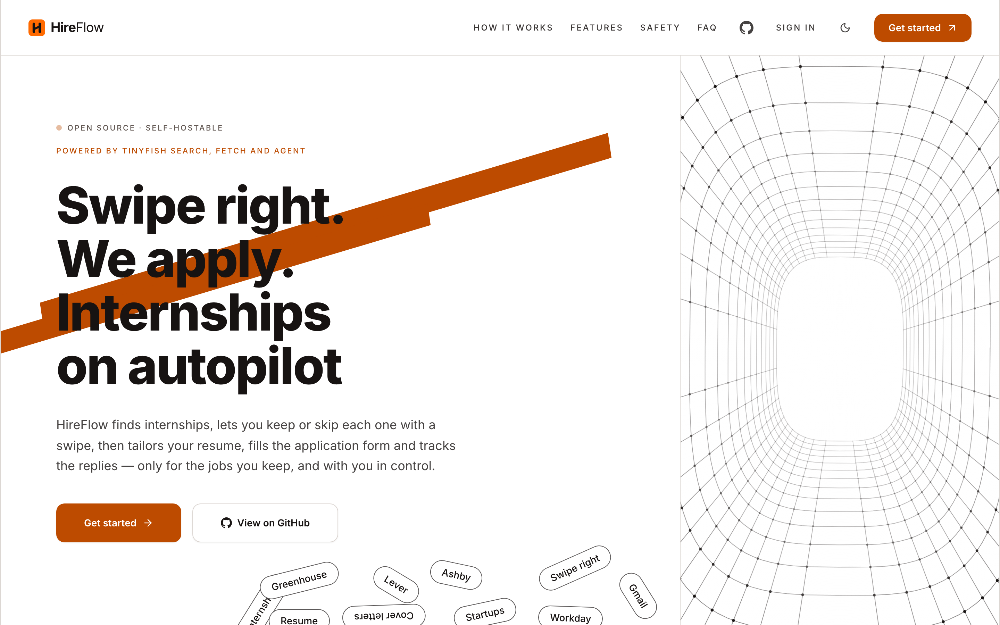
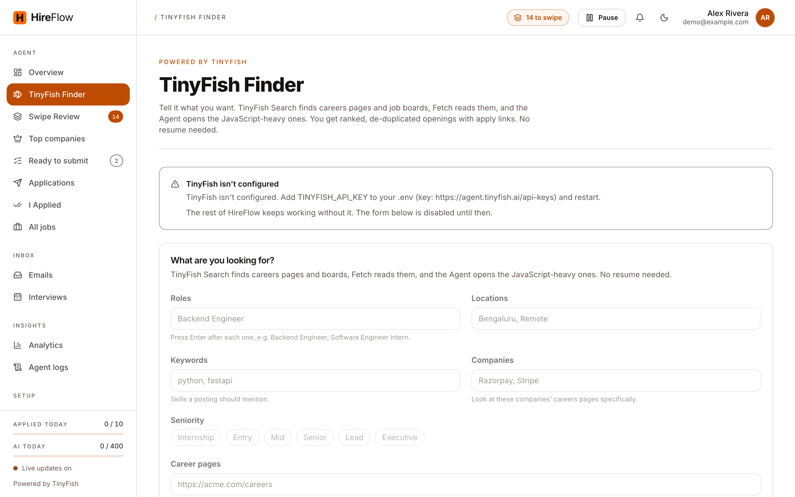
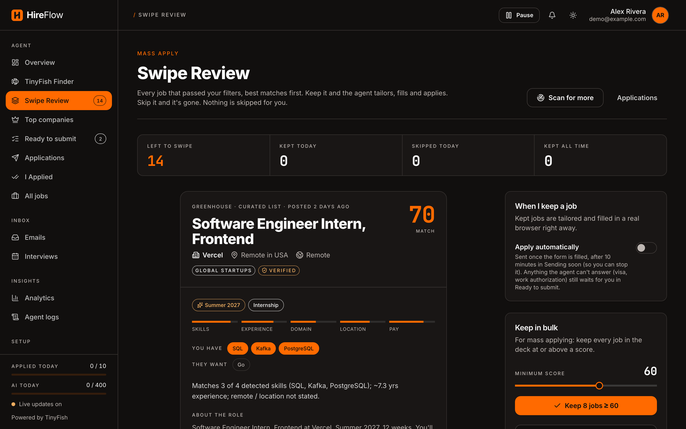
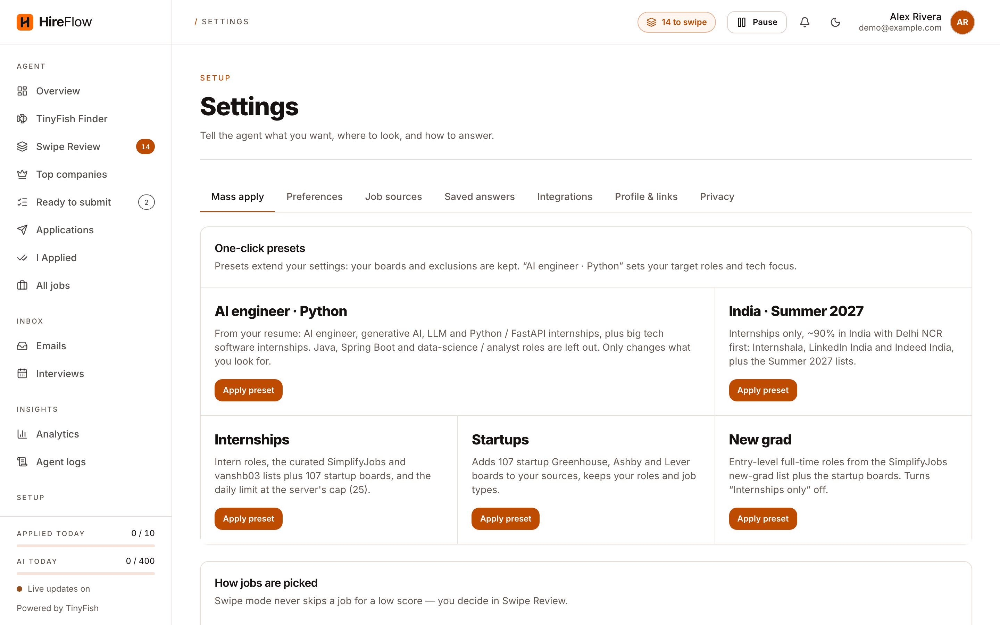
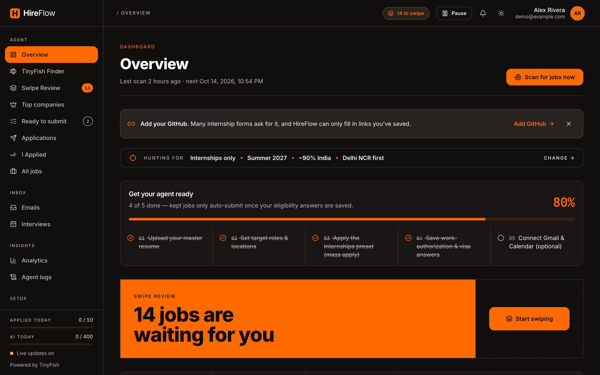
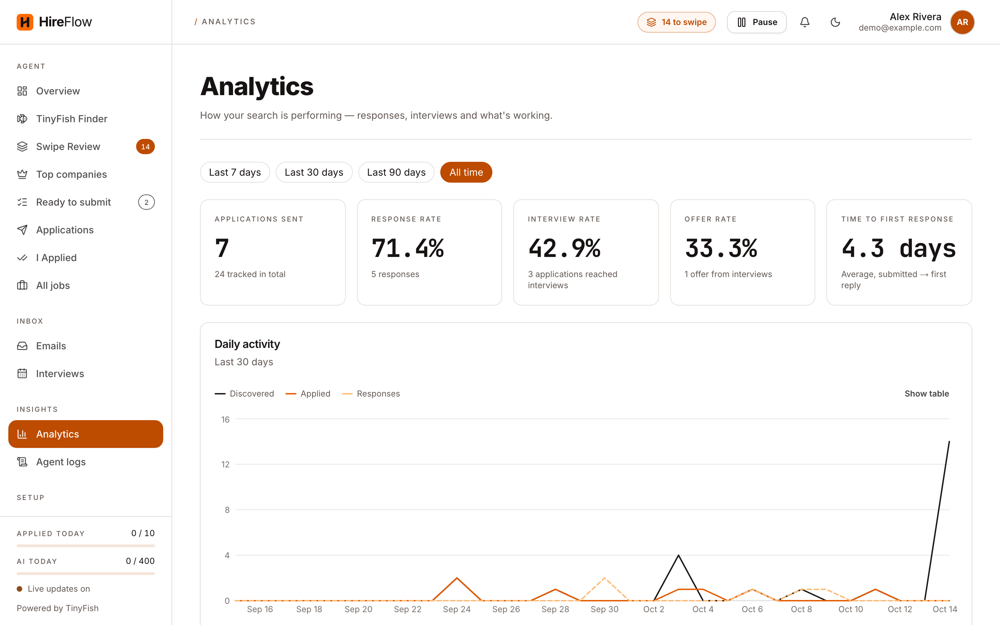
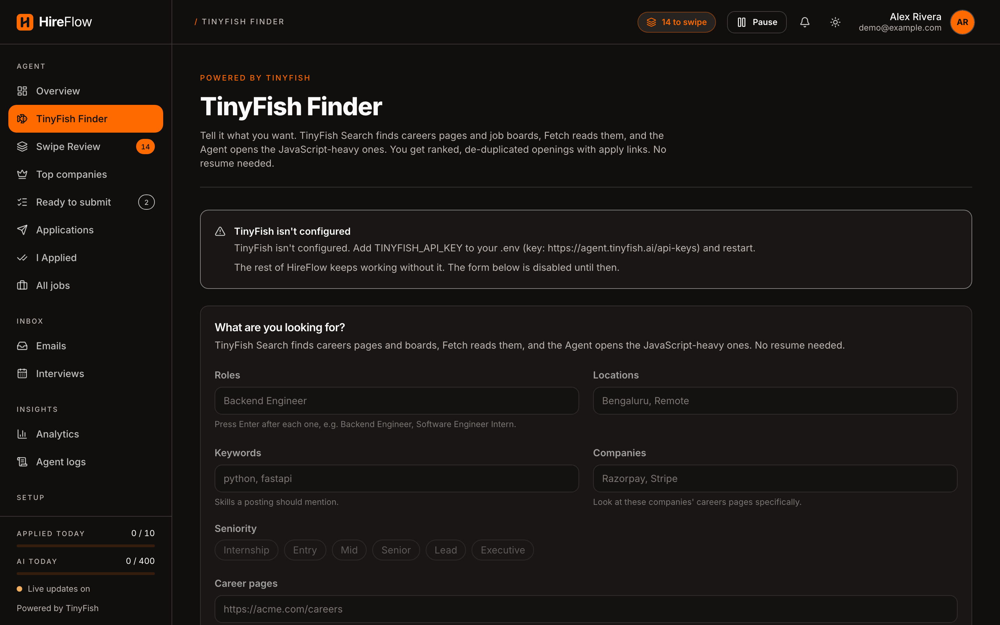
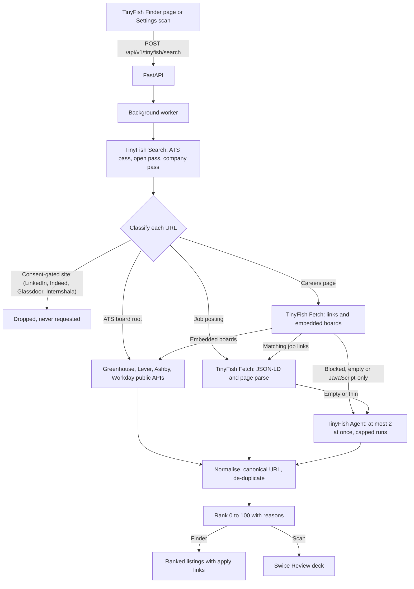

<p align="center">
  
</p>

<h1 align="center">HireFlow × TinyFish</h1>

<p align="center"><b>Tell it what you want. TinyFish finds the openings on live careers pages and job boards, and HireFlow ranks them.</b><br />A job and internship finder that needs no resume, built on TinyFish Search, Fetch and Agent.</p>

<p align="center">
  <a href="https://github.com/saksham-eng560/TinyFish/actions/workflows/ci.yml"></a>
  <a href="docs/TESTING.md"></a>
  <a href="LICENSE"></a>
</p>

<p align="center">
  <a href="#how-tinyfish-is-used"><b>How TinyFish is used</b></a> ·
  <a href="#quick-start">Quick start</a> ·
  <a href="#demo-steps">Demo</a> ·
  <a href="#safety">Safety</a> ·
  <a href="#research-foundations">Research</a> ·
  <a href="docs/TINYFISH.md">TinyFish docs</a> ·
  <a href="docs/SUBMISSION.md">Submission</a>
</p>

HireFlow is a job and internship finder that runs on your own computer. Tell the **TinyFish Finder** your roles,
locations, keywords, seniority and visa needs. TinyFish Search finds careers pages and job boards, TinyFish Fetch reads
them live, and the TinyFish Agent opens the JavaScript-heavy portals that a plain request can't read. You get one
list of structured, de-duplicated openings, scored from 0 to 100 with the reasons, each with an apply link. No resume is
needed to try it. Keep the ones you like and HireFlow adds them to your **Swipe Review** deck.

Everything runs on your computer. Your preferences and data stay in your own database, and TinyFish is only called
with the search terms and the public careers pages it has to read.

<p align="center"></p>

### Screenshots

<table>
  <tr>
    <td width="50%"><br /><sub><b>TinyFish Finder.</b> Set roles, locations, keywords, seniority and visa needs. No resume needed.</sub></td>
    <td width="50%"><br /><sub><b>Swipe Review.</b> Every match, best first, with a 0 to 100 score and the reasons.</sub></td>
  </tr>
  <tr>
    <td><br /><sub><b>Settings.</b> TinyFish status, a Test connection button and the Agent budget per scan.</sub></td>
    <td><br /><sub><b>Overview.</b> What's waiting for you, what was sent and how employers are answering.</sub></td>
  </tr>
  <tr>
    <td><br /><sub><b>Analytics.</b> Response, interview and offer rates.</sub></td>
    <td><br /><sub><b>Dark theme.</b> Near-black surfaces with TinyFish orange accents.</sub></td>
  </tr>
</table>

> The Finder screenshots were taken before an API key was added, so they show the form and the "add
> TINYFISH_API_KEY" banner rather than live results. The Overview, Swipe Review and Analytics cards use the built-in
> sample account (`make seed`).

## How TinyFish is used

HireFlow calls all three TinyFish endpoints. Each one does a different job, and the Finder shows every call live.

| Endpoint | Role in HireFlow | Example | When it runs |
|---|---|---|---|
| **Search** | Discovery: finds job boards, company careers pages and single postings for your roles and places | `GET https://api.search.tinyfish.ai/` with `query="backend engineer intern"`, `include_domains=boards.greenhouse.io,jobs.lever.co,...`, `exclude_domains` set to the consent-gated sites | First, for every Finder search and every scan that uses TinyFish |
| **Fetch** | Reading: returns the live text and links of a careers page or posting (`ttl=0`, so nothing is cached) and its JSON-LD job data | `POST https://api.fetch.tinyfish.ai/` with `urls` (up to 10), `format="html"` or `"markdown"`, `ttl=0` | After Search, for every page that Search found |
| **Agent** | Extraction: a browser agent for pages Fetch can't read (JavaScript apps, "load more" lists, bot checks), returning jobs in a fixed JSON schema | `POST https://agent.tinyfish.ai/v1/automation/run-sse` with a numbered goal and `output_schema` | Only as a fallback, capped by your run budget. Its live browser view is shown in the Finder |

Search finds the openings, Fetch reads the pages, and the Agent handles the pages that need a real browser. Details,
limits and the ranking formula: [docs/TINYFISH.md](docs/TINYFISH.md).

## Architecture



The Finder runs the same pipeline as a scan. The full picture, with the data flow and the code map, is in
[docs/ARCHITECTURE.md](docs/ARCHITECTURE.md).

## Features

- **No resume needed.** The Finder ranks from your preferences alone. A resume is only used for tailoring later.
- **Your preferences:** roles, locations, keywords, companies, seniority, visa sponsorship, remote only, posted-within
  window, and your own careers page URLs (up to 5).
- **Live progress:** Search, Fetch and Agent cards light up as they run, with the Agent's current step and a
  "Watch live" view of its browser when TinyFish provides one.
- **Ranked, not dumped:** every listing gets a 0 to 100 score and a "Why this ranks" breakdown: title 35, location 20,
  seniority 15, keywords 15, recency 10, visa 5.
- **Structured and de-duplicated:** one entry per job, even when it was found through a board, a careers page and a
  search result at once. Each entry shows its company, location, ATS, and the route it was found by.
- **Apply links, not auto-apply:** each listing opens its original posting in a new tab. Saving a listing only adds it
  to Swipe Review. Nothing is submitted.
- **Works in scans too:** TinyFish is one more source in the normal scan, with live detail text in the progress bar.
- **Works without a key:** without `TINYFISH_API_KEY`, the Finder shows a clear "add the key" message and every other
  source works as before.
- **Light and dark themes:** orange and black, with every text pair checked to WCAG AA (4.5:1) by
  `scripts/check_contrast.py`.

## Research foundations

HireFlow × TinyFish is an engineering project, not a research paper, but its design follows published work on web
agents, information retrieval, person-job matching, record linkage and LLM safety. The table says what each paper
contributed and **where the idea shows up in this code**. These are design influences: HireFlow does not reimplement
the models in these papers (no neural person-job fit model is trained here, for example).

### 1. Web agents: reading and acting on live websites

| Paper | Idea we use | Where in HireFlow |
|---|---|---|
| Yao et al., **ReAct: Synergizing Reasoning and Acting in Language Models**, ICLR 2023. [arXiv:2210.03629](https://arxiv.org/abs/2210.03629) | Interleave a reasoning step with an action, observe, repeat | The TinyFish Agent's step loop; its `PROGRESS` events (one per step) stream into the Finder as live status ([`scrapers/tinyfish.py`](backend/app/scrapers/tinyfish.py)) |
| Nakano et al., **WebGPT: Browser-assisted question-answering with human feedback**, 2021. [arXiv:2112.09332](https://arxiv.org/abs/2112.09332) | Search first, then read the pages you found, instead of answering from memory | The Search, then Fetch, pipeline: every listing comes from a page read live (`ttl=0`), never from hardcoded data |
| Zhou et al., **WebArena: A Realistic Web Environment for Building Autonomous Agents**, ICLR 2024. [arXiv:2307.13854](https://arxiv.org/abs/2307.13854) | Real websites are hard for agents: long tasks, dynamic pages, low success rates | Why the Agent is a **targeted fallback** with a step budget and a time cap, not the default path |
| Deng et al., **Mind2Web: Towards a Generalist Agent for the Web**, NeurIPS 2023. [arXiv:2306.06070](https://arxiv.org/abs/2306.06070) | Agents must generalise across unseen sites and domains | One goal template and schema for any careers site, with no per-site scripts ([`build_agent_goal`](backend/app/scrapers/tinyfish_parse.py)) |
| He et al., **WebVoyager: Building an End-to-End Web Agent with Large Multimodal Models**, ACL 2024. [arXiv:2401.13919](https://arxiv.org/abs/2401.13919) | End-to-end agents on live, JavaScript-heavy sites | Pages that Fetch reports as `bot_blocked`, `login_required` or a JavaScript shell are escalated to the Agent |
| Zheng et al., **GPT-4V(ision) is a Generalist Web Agent, if Grounded** (SeeAct), ICML 2024. [arXiv:2401.01614](https://arxiv.org/abs/2401.01614) | Grounding actions in the real page is the hard part | Every URL the Agent returns is checked (https only, same site or a known ATS) before it becomes a listing ([`agent_jobs_to_scraped`](backend/app/scrapers/tinyfish_parse.py)) |
| Yao et al., **WebShop: Towards Scalable Real-World Web Interaction with Grounded Language Agents**, NeurIPS 2022. [arXiv:2207.01206](https://arxiv.org/abs/2207.01206) | Turn a user's stated preferences into search and selection on the web | Role, location, seniority and visa needs become Search queries and Agent goals |
| Schick et al., **Toolformer: Language Models Can Teach Themselves to Use Tools**, NeurIPS 2023. [arXiv:2302.04761](https://arxiv.org/abs/2302.04761) | Call an external tool only when it adds something | Each TinyFish endpoint runs only when the previous stage needs it, so none of the three is padding |

### 2. Structured extraction from web pages

| Paper | Idea we use | Where in HireFlow |
|---|---|---|
| Ferrara et al., **Web Data Extraction, Applications and Techniques: A Survey**, Knowledge-Based Systems 2014. [arXiv:1207.0246](https://arxiv.org/abs/1207.0246) | Prefer the page's own structured data, fall back to layout heuristics | `parse_posting_html` reads schema.org `JobPosting` JSON-LD first, then the `h1` and `main` text |
| Willard and Louf, **Efficient Guided Generation for Large Language Models**, 2023. [arXiv:2307.09702](https://arxiv.org/abs/2307.09702) | Constrain model output to a schema so it can be parsed reliably | The Agent always runs with `output_schema` (`JOBS_OUTPUT_SCHEMA`), and each field is validated afterwards |
| Zhang et al., **SkillSpan: Hard and Soft Skill Extraction from English Job Postings**, NAACL 2022. [arXiv:2204.12811](https://arxiv.org/abs/2204.12811) | Skills are spans inside the posting text | Keyword and skill hits in the description feed the ranker's 15-point keyword factor and the "skills you have / they want" chips |

### 3. Ranking and matching

| Paper | Idea we use | Where in HireFlow |
|---|---|---|
| Robertson and Zaragoza, **The Probabilistic Relevance Framework: BM25 and Beyond**, Foundations and Trends in IR, 2009. [doi:10.1561/1500000019](https://doi.org/10.1561/1500000019) | Score relevance from term evidence, with saturation so one repeated word can't dominate | The preference ranker caps every factor (title 35, location 20, seniority 15, keywords 15, recency 10, visa 5) ([`tinyfish_ranker.py`](backend/app/services/tinyfish_ranker.py)) |
| Järvelin and Kekäläinen, **Cumulated Gain-Based Evaluation of IR Techniques**, ACM TOIS 2002. [doi:10.1145/582415.582418](https://doi.org/10.1145/582415.582418) | Users mostly read the top of a list, so ordering matters more than the long tail | Results are sorted best first, and a minimum-score cut drops the weak tail |
| Zhu et al., **Person-Job Fit: Adapting the Right Talent for the Right Job with Joint Representation Learning**, ACM TMIS 2018. [arXiv:1810.04040](https://arxiv.org/abs/1810.04040) | Person-job fit compares what a job requires with what a candidate offers | Resume-based scoring: skills, experience, domain, location and pay, each shown as its own bar on the Swipe Review card ([`job_matcher.py`](backend/app/services/job_matcher.py)) |
| Qin et al., **Enhancing Person-Job Fit for Talent Recruitment: An Ability-aware Neural Network Approach**, SIGIR 2018. [arXiv:1812.08947](https://arxiv.org/abs/1812.08947) | Explain a match through the abilities a job asks for | Every score comes with reasons ("Why this ranks", "you have / they want"), never a bare number |
| Weinberger et al., **Feature Hashing for Large Scale Multitask Learning**, ICML 2009. [arXiv:0902.2206](https://arxiv.org/abs/0902.2206) | Hash words straight into a fixed-size vector: no vocabulary, no model download | The default local embedder (`EMBEDDING_PROVIDER=local`) used for resume-to-job cosine similarity ([`embeddings.py`](backend/app/services/embeddings.py)) |
| Reimers and Gurevych, **Sentence-BERT: Sentence Embeddings using Siamese BERT-Networks**, EMNLP 2019. [arXiv:1908.10084](https://arxiv.org/abs/1908.10084) | Compare texts by the cosine of their sentence embeddings | `cosine_similarity(resume, job)` orders new matches when a neural embedder is configured |
| Nussbaum et al., **Nomic Embed: Training a Reproducible Long Context Text Embedder**, 2024. [arXiv:2402.01613](https://arxiv.org/abs/2402.01613) | An open, local embedding model | The `EMBEDDING_PROVIDER=ollama` option (`nomic-embed-text`), which runs on your own computer |

### 4. De-duplication and record linkage

| Paper | Idea we use | Where in HireFlow |
|---|---|---|
| Fellegi and Sunter, **A Theory for Record Linkage**, JASA 1969. [doi:10.1080/01621459.1969.10501049](https://doi.org/10.1080/01621459.1969.10501049) | Decide whether two records are the same entity by comparing their fields | `dedupe_key(company, title, location)` merges one job found on a board, a careers page and a search result ([`text_utils.py`](backend/app/services/text_utils.py)) |
| Li et al., **Deep Entity Matching with Pre-Trained Language Models** (Ditto), PVLDB 2021. [arXiv:2004.00584](https://arxiv.org/abs/2004.00584) | Normalise fields before matching them | Company and title are normalised before keying, and URLs are canonicalised (tracking parameters, fragments and trailing slashes stripped) by `canonical_url` |
| Broder, **On the Resemblance and Containment of Documents**, Compression and Complexity of Sequences 1997. [doi:10.1109/SEQUEN.1997.666900](https://doi.org/10.1109/SEQUEN.1997.666900) | Near-duplicate web documents are common and must be collapsed | Two-level dedupe (exact canonical URL, then the field key), with the richest copy kept: ATS API, then Fetch, then Agent, then snippet |

### 5. Safety: untrusted pages and truthful output

| Paper | Idea we use | Where in HireFlow |
|---|---|---|
| Greshake et al., **Not What You've Signed Up For: Compromising Real-World LLM-Integrated Applications with Indirect Prompt Injection**, AISec 2023. [arXiv:2302.12173](https://arxiv.org/abs/2302.12173) | Text on a web page can carry instructions aimed at the model reading it | Page text passes through `sanitize_untrusted` before any LLM sees it; the Agent goal forbids logins, forms and submissions; Agent output is schema-checked ([`llm.py`](backend/app/services/llm.py)) |
| Ji et al., **Survey of Hallucination in Natural Language Generation**, ACM Computing Surveys 2023. [arXiv:2202.03629](https://arxiv.org/abs/2202.03629) | Generated text can state things the source never said | Resume tailoring is checked line by line against your real resume, so nothing is invented ([`resume_tailor.py`](backend/app/services/resume_tailor.py)) |
| Min et al., **FActScore: Fine-grained Atomic Evaluation of Factual Precision in Long Form Text Generation**, EMNLP 2023. [arXiv:2305.14251](https://arxiv.org/abs/2305.14251) | Check generated text one atomic claim at a time | The same line-by-line check, and the Agent prompt's rule to return `null` instead of guessing a missing field |
| Lewis et al., **Retrieval-Augmented Generation for Knowledge-Intensive NLP Tasks**, NeurIPS 2020. [arXiv:2005.11401](https://arxiv.org/abs/2005.11401) | Ground generation in retrieved documents | Cover letters and answers are written from the fetched job description and your own resume, not from the model's memory |

## Quick start

You need **Git**, **Python 3.11 or newer** and **Node.js 20 or newer**. On macOS, `brew install git python@3.12 node`
installs them. On Ubuntu or WSL, `sudo apt install -y git python3 python3-venv python3-pip nodejs npm` does it (use
Node 20 from https://nodejs.org if `node -v` shows an older version).

### 1. Get a TinyFish API key

1. Create an account and a key at **https://agent.tinyfish.ai/api-keys**.
2. Keep the key private. HireFlow reads it from `.env` only. It is never stored in the database, never sent to the
   browser, and never shown in the app.

### 2. Download and start HireFlow

```bash
git clone https://github.com/saksham-eng560/TinyFish.git
```

```bash
cd TinyFish
```

```bash
./start.sh
```

The first run takes 3 to 5 minutes. It installs the Python packages, the browser HireFlow uses for forms, and the
dashboard, and creates a `.env` file if there isn't one. When it's ready, your browser opens **http://localhost:3000**.
Press **Ctrl-C** in the terminal to stop.

### 3. Add your key

Open `.env` (on a Mac, `open -e .env`; on Linux or WSL, `nano .env`) and set:

```bash
TINYFISH_API_KEY=paste-your-key-here
```

Save, then restart: **Ctrl-C**, then `./start.sh`. `TINYFISH_API_KEY` is the only key you need for the Finder.

### 4. Optional keys, added later

HireFlow works without these. Add them to the same `.env` file whenever you want the feature:

| Key in `.env` | What it adds | Where to get it |
|---|---|---|
| `ANTHROPIC_API_KEY` or `OPENAI_API_KEY` | Better tailoring, cover letters and answers | https://console.anthropic.com or https://platform.openai.com |
| `OLLAMA_MODEL` | Free AI on your own computer, no key | [docs/OLLAMA.md](docs/OLLAMA.md) |
| `GOOGLE_CLIENT_ID` and `GOOGLE_CLIENT_SECRET` | **Continue with Google** sign-in, and Gmail and Calendar | [Sign in with Google](docs/USER_GUIDE.md#sign-in-with-google) |
| `CAPTCHA_API_KEY` | Captcha solving for form filling | https://2captcha.com |

After adding a key, restart HireFlow. Settings › Integrations shows which features are on.

### Check that TinyFish is connected

Open **Settings › Integrations**, find the **TinyFish** card and press **Test connection**. It runs one Search. A
green "Connected" line means the key works. The key itself is never displayed.

### Everyday commands

| Command | What it does |
|---|---|
| `./start.sh` | Start HireFlow at http://localhost:3000 |
| `./start.sh --demo` | Practice mode: fictional jobs, nothing really sent |
| `./start.sh --reset` | Start over with an empty database |
| `make test` | Run the backend tests |
| `make lint` | Lint the backend, the dashboard, and check the colour contrast |

## Demo steps

1. Start HireFlow with `./start.sh` and create an account at http://localhost:3000. You don't need to upload a resume.
2. Open **TinyFish Finder** in the sidebar (under **Agent**, right after Overview). The page says "Powered by TinyFish".
3. Press **Use my preferences** to fill the form from your settings, or type your own roles (for example
   *Backend Engineer* and *Software Engineer Intern*), a location, and some keywords.
4. Press **Find openings**. Watch the three cards for **Search**, **Fetch** and **Agent** count up. Press **Watch live**
   on the Agent card to see its browser when a run starts.
5. When the search finishes, the results show a score, the reasons, the company, the ATS host and the route each job
   came from. Press **Apply** to open the original posting in a new tab.
6. Tick the listings you want and press **Save N to Swipe Review**. Open **Swipe Review** to see them as cards.

Without a key, step 4 shows the "add TINYFISH_API_KEY" message instead, and the rest of HireFlow works as before.

## Safety

- **Consent-gated sites are never sent to TinyFish.** LinkedIn, Indeed, Glassdoor and Internshala stay behind the
  consent rules in the app. Search excludes them, and a second check drops any such URL before it is requested. Tests
  assert this.
- **No auto-apply from the Finder.** Saving a listing only creates a Swipe Review card. Nothing is sent to an employer.
- **Agent budget.** Each scan uses at most your **Agent runs per scan** setting (default 2, the hard ceiling is 5).
  Scheduled scans use at most 1 run. At most 2 Agent runs run at once, each with a time limit.
- **Untrusted pages.** Careers pages and Agent output are treated as data. Only `https` apply links from the employer
  or a known job board are kept. The Agent is told never to log in, fill forms or submit anything.
- **Your key stays on your computer.** It lives in `.env` and is never written to the database, logs or the browser.
- **Quota errors pause TinyFish, not HireFlow.** A 401, 402 or 429 is shown in the source list and every other source
  keeps running.

Details: [docs/TINYFISH.md](docs/TINYFISH.md) and [docs/SECURITY.md](docs/SECURITY.md).

## Verification status

- The TinyFish API contracts (hosts, headers, request fields, limits and error codes) were checked against the TinyFish
  documentation, and one live Search call was made and recorded.
- The automated tests use mocked TinyFish responses. They do not make network calls.
- The full end-to-end run (a live search, live Fetch and a live Agent run) needs your own TinyFish key. Follow the steps
  above to run it.

## Troubleshooting

<details>
<summary><b>TinyFish</b></summary>

| You see | Do this |
|---|---|
| "TinyFish isn't configured" | Add `TINYFISH_API_KEY` to `.env` (key at https://agent.tinyfish.ai/api-keys), then restart. |
| "TINYFISH_API_KEY is invalid or was rejected (HTTP 401)" | Check the key for spaces or quotes, or create a new one. |
| A quota or credits message (HTTP 402, or a 429 with limit details) | TinyFish is paused for that period and the other sources keep running. Check your TinyFish account. |
| "TinyFish ... is rate limiting requests" (HTTP 429) | Wait a minute and search again. Lower the number of roles or companies if it keeps happening. |
| A page shows "bot blocked" or stays empty | The Agent is used for it when your run budget allows. Raise **Agent runs per scan** in Settings, or add the careers page URL directly. |

More: [docs/TINYFISH.md#troubleshooting](docs/TINYFISH.md#troubleshooting).
</details>

<details>
<summary><b>Starting HireFlow</b></summary>

| You see | Do this |
|---|---|
| `Python 3.11+ is required` / `Node.js 20+ is required` | Install a newer version (see the first lines of [Quick start](#quick-start)). |
| `Port 3000 is already in use` | Close the other app, or start with `WEB_PORT=3001 ./start.sh`. For port 8000, use `API_PORT`. |
| `Chromium install failed` | Run `backend/.venv/bin/python -m playwright install chromium` (on Linux add `--with-deps`). |
| "Can't reach the HireFlow server right now" | Look for an error in the terminal, or in `logs/api.log`. |
</details>

Anything else: the logs are in the `logs/` folder (`api.log`, `web.log`).

## Docs

| | |
|---|---|
| [TinyFish in HireFlow](docs/TINYFISH.md) | The endpoints, limits, pipeline, budget settings, ranking and the Finder API |
| [Submission checklist](docs/SUBMISSION.md) | Requirement-to-evidence map, demo script, and steps to run and test |
| [User guide](docs/USER_GUIDE.md) | Every screen and setting, including the TinyFish Finder |
| [Architecture](docs/ARCHITECTURE.md) | How the pieces fit, and where each guardrail lives |
| [Free AI with Ollama](docs/OLLAMA.md) | Models, Ollama Cloud, Docker, troubleshooting |
| [AI models](docs/AI_MODELS.md) | Claude, OpenAI and Ollama compared |
| [Running and self-hosting](docs/SELF_HOSTING.md) | Docker, development setup, your own server |
| [Testing](docs/TESTING.md) | What's tested and how to run it |
| [Security and responsible use](docs/SECURITY.md) | How your data is protected, and the rules for using job sites |

## Origin

HireFlow began as AutoApply AI. Its full history is in [docs/HIREFLOW_PLAN.md](docs/HIREFLOW_PLAN.md).

## License

[MIT](LICENSE)
